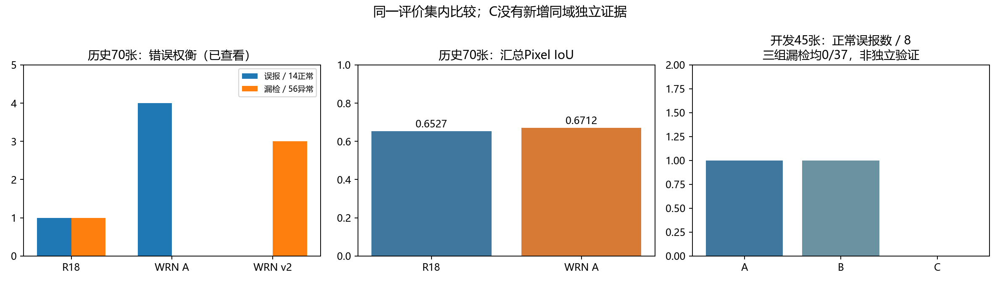

# 工业视觉异常检测与定位

面向**目标产品缺陷样本稀缺**的离线检测项目：用正常图片建立 PatchCore 特征库，对新图片输出异常判断、热力图、缺陷掩码和可追溯报告。已完成 MVTec AD metal_nut 的实验评估、错误诊断、单图/批量推理和桌面演示；作者已于2026-10-28确认GUI可正常运行。

适合希望研究**评分机制、阈值选择、定位质量与推理成本**的计算机视觉学习者和研究者。默认采用 R18；WRN50 A 提供定位/召回取舍，Top-K（K=11）提供实验候选入口。

[核心实验汇总](05项目文档/最终交付/核心实验汇总.md) · [快速开始](05项目文档/最终交付/无模型快速开始.md) · [检测与模型安装](05项目文档/最终交付/研究模型包使用.md) · [主题文档导航](05项目文档/最终交付/交付导航.md)

## 四项核心成果

|成果|实测证据|结论与适用范围|
|---|---|---|
|建立可追溯参考检测方案|历史70图：R18图像AUROC 0.9962，误报1/14、漏检1/56，汇总Pixel IoU 0.6527|176建库/44校准/45开发/70历史测试；记录模型、划分和参数身份|
|量化骨干替换的收益与代价|同70图WRN50 A：IoU 0.6712、漏检0/56，但误报4/14；同协议GPU平均前向7.015→17.047ms|定位IoU增加1.85个百分点，不能称为低成本全面升级；计时不含I/O等|
|完成图像评分机制对照|45开发图：A/B误报1/8，C误报0/8，三组漏检均0/37、AUROC均1.0|C改变图像评分；尚未获得新增同域独立证据，不宣称改善像素定位|
|验证适用域并交付可复核工程|5880张不同六角螺母跨域测试，三组正常误报均1476/1476；模型包有SHA、配置校验和独立测试入口|识别域偏移失效边界；提供完整检测与证据复核流程，不将跨域成绩混入原任务|

70张历史测试图已被查看和分析；后续阈值/候选比较不是新的独立测试。统计口径、其他对照、原始证据定位与不足见[核心实验汇总](05项目文档/最终交付/核心实验汇总.md)。

## 一分钟复核：不用 GPU、模型或图片

只需 Python 3.10+，在源码根目录执行：

~~~powershell
python -B -S "02代码与配置/scripts/run_public_score_summary.py"
python -B -S "02代码与配置/scripts/run_tests.py" --suite basic
~~~

第一条从公开的**分数频次摘要**重算 A/B/C 指标，核对30项记录；第二条运行不依赖第三方包的基础测试。输出写入新的04实验结果目录。原图、逐图路径、判断和配对错误案例保留本地。

## 检测自己的图片

按[环境安装](05项目文档/最终交付/环境安装.md)配置依赖，取得符合用途许可的研究模型包后：

~~~powershell
python -B "02代码与配置/scripts/install_model_release.py" --profile r18_reference --archive "r18-reference-v1.zip"
.venv/Scripts/python.exe -B "02代码与配置/scripts/delivery_runtime.py" --profile r18_reference --device cpu --image "你的图片.png"
~~~

批量输入使用 --input-dir；桌面GUI为 delivery_app.py，也可使用01运行入口中的“打开最终演示”。输出含原图、热力图、叠加图、掩码、连续分数、JSON与HTML。图像判断与像素掩码独立。

**模型获取状态：两个研究模型ZIP已在本地准备并验证；公开Release尚未发布，没有可用公网下载地址。** --download 会明确提示此状态，不假装下载成功。完整步骤、各版本选择和许可证见[研究模型包使用](05项目文档/最终交付/研究模型包使用.md)。

## 技术结构

~~~mermaid
flowchart LR
  N[正常建库图] --> F[冻结骨干特征]
  F --> M[Coreset正常特征库]
  I[输入图片] --> P[统一预处理]
  P --> Q[多层Patch特征]
  Q --> D[最近邻距离]
  M --> D
  D --> S[邻居加权 / 最大距离 / Top-K]
  D --> H[上采样与平滑]
  S --> A[图像阈值判定]
  H --> B[像素阈值掩码]
~~~

PatchCore参考实现来自 anomalib；本项目贡献集中于数据与评价协议、评分及阈值诊断、质量/资源对照和工程封装。未宣称从零实现完整PatchCore、自建数据集或已经实现EfficientAD。

## 文档与目录

|想做什么|入口|
|---|---|
|了解指标、收益、失败案例与不足|[核心实验汇总](05项目文档/最终交付/核心实验汇总.md)|
|安装依赖与运行检测|[环境安装](05项目文档/最终交付/环境安装.md)、[研究模型包使用](05项目文档/最终交付/研究模型包使用.md)|
|检查模型SHA和缺失文件|[模型获取与导入](05项目文档/最终交付/模型包获取与导入.md)|
|贡献代码、运行测试|[测试与验证](05项目文档/最终交付/测试与验证.md)|
|了解许可与发布范围|[模型许可核查](05项目文档/最终交付/模型发布许可核查.md)、[第三方说明](THIRD_PARTY_NOTICES.md)|
|准备简历与面试|[简历与面试](05项目文档/最终交付/简历与面试.md)|

代码/配置/测试在02代码与配置；本地数据在03原始数据；完整实验和逐图报告在04实验结果；文档在05项目文档。历史记录保留，但不作为首页阅读主线。

## 使用边界

代码及自有文档为[MIT](LICENSE)；模型、数据和第三方组件分别遵守原许可。模型包面向非商业研究用途，不能按源码MIT推定可商用。当前主要证据来自单类别和小规模开发集；只有3张开发小面积缺陷，C没有新增同域独立可靠性验证。已验证同机Windows隔离环境与CPU运行，跨机器/跨OS仍待验证。
