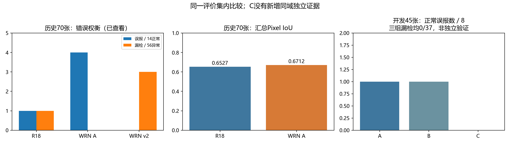
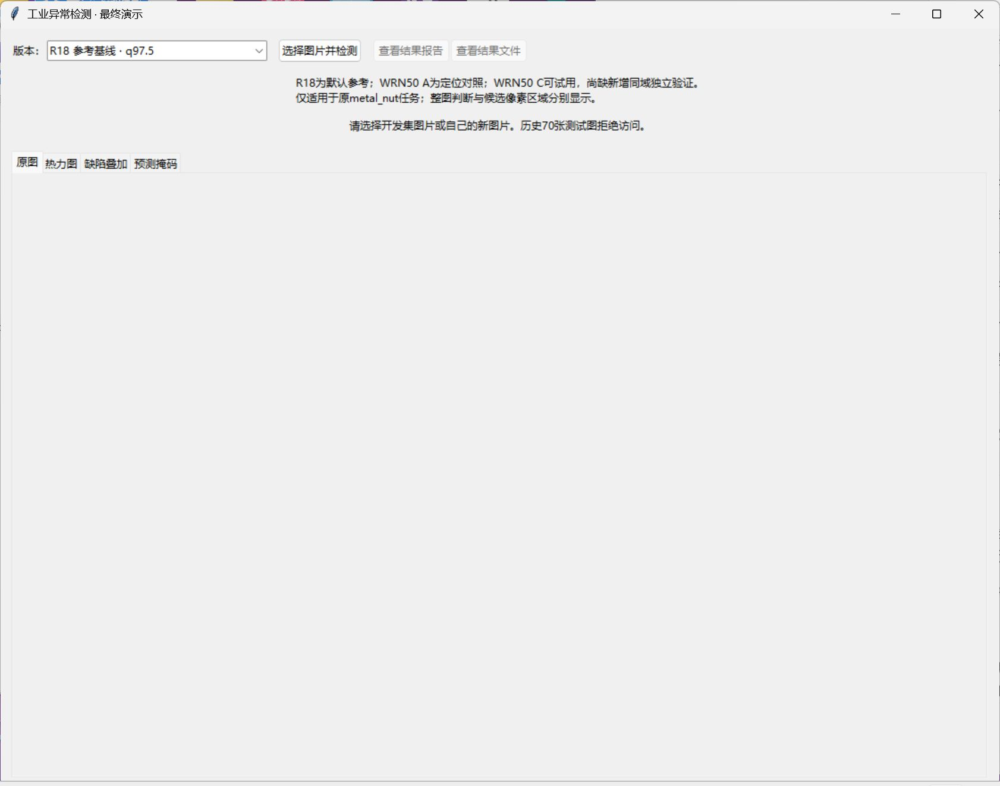
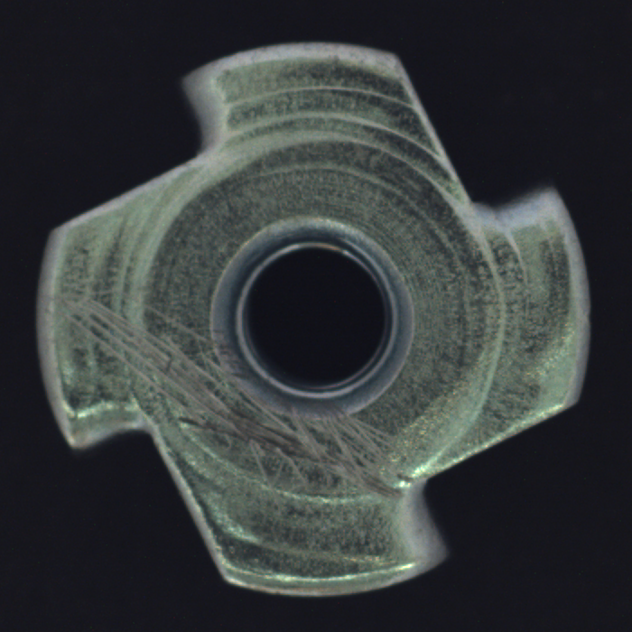
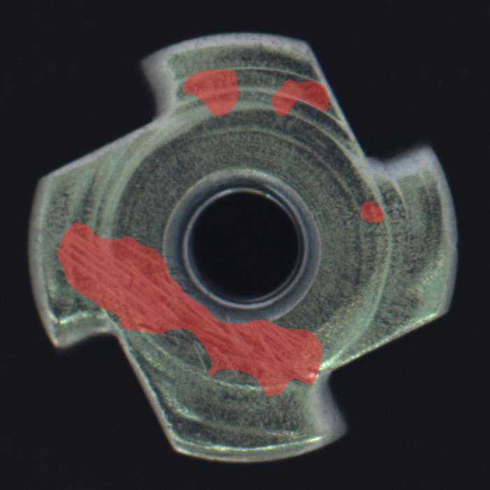

# 工业视觉异常检测与定位

面向**目标产品缺陷样本稀缺**的离线检测项目：用正常图片建立 PatchCore 特征库，对新图片输出异常判断、热力图、缺陷掩码和检测报告。提供 MVTec AD metal_nut 的既有实验分析、单图/批量推理、桌面界面和研究模型下载。当前定位为算法复现与离线检测原型，适用范围见下方实验和使用边界。

适合希望研究**评分机制、阈值选择、定位质量与推理成本**的计算机视觉学习者和研究者。默认采用 R18；WRN50 A 提供定位/召回取舍，Top-K（K=11）提供实验候选入口。

[核心实验汇总](05项目文档/最终交付/核心实验汇总.md) · [快速开始](05项目文档/最终交付/无模型快速开始.md) · [检测与模型安装](05项目文档/最终交付/研究模型包使用.md) · [主题文档导航](05项目文档/最终交付/交付导航.md)

## 四项核心成果

|成果|实测证据|结论与适用范围|
|---|---|---|
|建立可追溯参考检测方案|历史70图：R18图像AUROC 0.9962，误报1/14、漏检1/56，汇总Pixel IoU 0.6527|176建库/44校准/45开发/70历史测试；记录模型、划分和参数身份|
|量化骨干替换的收益与代价|同70图WRN50 A：IoU 0.6712、漏检0/56，但误报4/14；同协议GPU平均前向7.015→17.047ms|定位IoU增加1.85个百分点，不能称为低成本全面升级；计时不含I/O等|
|完成图像评分机制对照|45开发图：A/B误报1/8，C误报0/8，三组漏检均0/37、AUROC均1.0|C改变图像评分；尚未获得新增同域独立证据，不宣称改善像素定位|
|验证适用域并交付检测入口|5880张不同六角螺母跨域测试，三组正常误报均1476/1476；模型包有SHA、配置校验和独立测试入口|记录域偏移失效边界；提供推理与摘要复核入口，不将跨域成绩混入原任务|

70张历史测试图已被查看和分析；后续阈值/候选比较不是新的独立测试。统计口径、其他对照、原始证据定位与不足见[核心实验汇总](05项目文档/最终交付/核心实验汇总.md)。

## 一分钟重算公开摘要：不用 GPU、模型或图片

只需 Python 3.10+，在源码根目录执行：

~~~powershell
python -B -S "02代码与配置/scripts/run_public_score_summary.py"
python -B -S "02代码与配置/scripts/run_tests.py" --suite basic
~~~

第一条从公开的**分数频次摘要**重算45张开发图的 A/B/C 图像指标，核对30项记录；第二条运行不依赖第三方包的22项基础测试。输出写入新的04实验结果目录。这两条命令不执行模型推理，也不重现70张历史测试或5880张跨域测试。

### 公开证据能验证什么

|材料或入口|可以验证|尚不能验证|
|---|---|---|
|[分数频次摘要](05项目文档/最终交付/公开复核摘要/score_frequencies.json)及重算命令|45张开发图 A/B/C 的排序指标、固定阈值计数；44张校准图的超限计数|原图到模型输出的过程、逐图配对差异、像素定位|
|[指标及来源清单](05项目文档/最终交付/公开指标及来源.json)|已有汇总计数与文档是否一致；从像素 TP/FP/FN 重算汇总 IoU|从原始分数独立重算历史70图 AUROC，或核验预测掩码和跨域逐图输出|
|[研究模型包](https://github.com/CJ2323232/industrial-anomaly-inspection/releases/tag/research-models-v1)|下载与文件身份校验；安装依赖后对输入图片运行检测|全部历史实验的精确复现、跨产品可靠性|

完整历史报告和逐图输出目前只保留在本地，公开 Git 历史不作为其获取渠道。来源清单中的 `04实验结果/...` 是本地证据定位，不是仓库内可下载文件。公开摘要重算、使用冻结模型推理、从图片重现实验是不同层次；本仓库没有提供完整的第三层历史复现材料。

## 检测自己的图片

按[环境安装](05项目文档/最终交付/环境安装.md)配置依赖，阅读研究模型用途许可后：

~~~powershell
python -B "02代码与配置/scripts/install_model_release.py" --profile r18_reference --download
.venv/Scripts/python.exe -B "02代码与配置/scripts/delivery_runtime.py" --profile r18_reference --device cpu --image "你的图片.png"
~~~

批量输入使用 --input-dir；桌面GUI为 delivery_app.py，也可使用01运行入口中的“打开最终演示”。输出含原图、热力图、叠加图、掩码、连续分数、JSON与HTML。图像判断与像素掩码独立。

**研究模型已公开发布。** [下载 R18 / WRN50 模型包](https://github.com/CJ2323232/industrial-anomaly-inspection/releases/tag/research-models-v1)，也可使用上方 `--download` 自动下载、校验和导入。2026-11-04发布验收记录包含服务器端ZIP回下载及外层/内部SHA校验，以及本机既有隔离环境中的独立源码目录下载、导入和CPU检测。文件校验与推理入口验收不等于重现实验精度。完整步骤、各版本选择和许可证见[研究模型包使用](05项目文档/最终交付/研究模型包使用.md)。

## 自动检查的范围

- [基础 CI](.github/workflows/basic-tests.yml)：Ubuntu和Windows、Python 3.10，使用 `-B -S` 运行22项标准库基础测试；不运行数值单元、真实模型、GUI或数据集评价。
- [代码检查](.github/workflows/code-quality.yml)：Black检查5个登记脚本的格式，范围见[配置](pyproject.toml)；未配置Ruff、mypy或全仓库类型检查。
- 完整CPU单元和真实模型集成入口见[测试与验证](05项目文档/最终交付/测试与验证.md)。CI绿灯仅对应实际执行的检查，不代表完整算法、模型精度或所有平台已验收；用例数量比例也不等于代码覆盖率。

## 技术结构

~~~mermaid
flowchart LR
  N[正常建库图] --> F[冻结骨干特征]
  F --> M[Coreset正常特征库]
  I[输入图片] --> P[统一预处理]
  P --> Q[多层Patch特征]
  Q --> D[最近邻距离]
  M --> D
  D --> S[邻居加权 / 最大距离 / Top-K]
  D --> H[上采样与平滑]
  S --> A[图像阈值判定]
  H --> B[像素阈值掩码]
~~~

PatchCore参考实现来自 anomalib；本项目贡献集中于数据与评价协议、评分及阈值诊断、质量/资源对照和工程封装。未宣称从零实现完整PatchCore、自建数据集或已经实现EfficientAD。

## 核心代码阅读导航

|入口|阅读重点|
|---|---|
|[基线与建库](02代码与配置/scripts/run_trusted_baseline.py)|`run`：176张正常图建库→44张校准→45张开发评价；[源码复现条件](05项目文档/最终交付/环境安装.md#从公开源码重新建库与校准)|
|[最近邻检索](02代码与配置/scripts/nearest_neighbors.py)|`exact_nearest_neighbors`：分块精确距离；这是保留的研究实现，默认推理仍走anomalib|
|[推理封装](02代码与配置/scripts/delivery_runtime.py)|`DeliveryInspector`：模型身份校验、单图/批量导出；[Top-K](02代码与配置/scripts/delivery_topk.py)仅替换图像评分|
|[桌面GUI](02代码与配置/scripts/delivery_app.py)|`main`：选图、异步检测、四视图、报告与输入错误提示|
|[评分评价](02代码与配置/scripts/run_public_score_summary.py)|`analyze_summary`：从已公开频次摘要复核指标；不读取图片、不新增实验|

真实GUI界面与展示素材

这是实际程序初始界面，不是模拟检测结果。下方为已有开发图scratch/021及WRN50 C的真实预测叠加（红色是预测候选区域，不是GT）。仅展示功能，不是新增独立验证。

 

图片来源：MVTec AD，MVTec Software GmbH；两图及叠加修改按[CC BY-NC-SA 4.0](https://creativecommons.org/licenses/by-nc-sa/4.0/)提供，**不属于代码MIT**。[完整署名、来源、修改和哈希](05项目文档/最终交付/展示/README.md)。

## 文档与目录

|想做什么|入口|
|---|---|
|了解指标、收益、失败案例与不足|[核心实验汇总](05项目文档/最终交付/核心实验汇总.md)|
|安装依赖与运行检测|[环境安装](05项目文档/最终交付/环境安装.md)、[研究模型包使用](05项目文档/最终交付/研究模型包使用.md)|
|检查模型SHA和缺失文件|[模型获取与导入](05项目文档/最终交付/模型包获取与导入.md)|
|贡献代码、运行测试|[测试与验证](05项目文档/最终交付/测试与验证.md)|
|了解许可与发布范围|[模型许可核查](05项目文档/最终交付/模型发布许可核查.md)、[第三方说明](THIRD_PARTY_NOTICES.md)|

公开代码/配置/测试在02代码与配置，公开文档在05项目文档。本地数据目录03原始数据、历史完整结果及新生成输出目录04实验结果不随源码克隆提供；运行相应入口后生成新的输出目录。

## 使用边界

代码及自有文档为[MIT](LICENSE)；模型、数据和第三方组件分别遵守原许可。模型包面向非商业研究用途，不能按源码MIT推定可商用。当前主要证据来自单类别和小规模开发集；只有3张开发小面积缺陷，C没有新增同域独立可靠性验证。已验证同机Windows隔离环境与CPU运行，跨机器/跨OS仍待验证。
