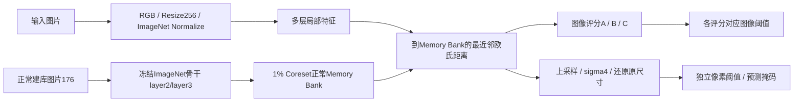

# 面向缺陷样本稀缺场景的工业视觉异常检测与定位

基于 MVTec AD metal_nut 与 anomalib 2.2.0 PatchCore 的可追溯实验及离线演示项目。用正常图片构建特征库，以局部特征到正常库的距离进行异常检测与定位。主要工作是数据协议、阈值和评分诊断、质量与资源对照、错误分析及工程交付；**不是从零独立实现 PatchCore，也没有自建工业数据集**。

最终演示默认 **R18 / 256 / sigma4 / 原始邻居加权评分**。WRN50 A 作为可切换的高召回与定位对照，C组Top-K（K=11）已提供可选入口，仍为实验候选。该选择面向资源成本与错误平衡，不代表证明R18普遍最好。

## 实际完成与证据边界

- 原始335张图：正常建库176、正常校准44、开发45（8正常/37异常）、历史测试70（14正常/56异常）。
- 70张历史测试图已经评价、诊断和复测；后续WRN50_v2及C组选择不能声称获得新的独立测试证据。
- 初次冻结历史70图：R18误报1/14、漏检1/56；WRN50 A误报4/14、漏检0/56。汇总像素IoU分别0.6527、0.6712，像素召回95.59%、96.13%。
- WRN50_v2仅提高图像阈值后，历史同70图误报0/14、漏检3/56，像素定位完全不变。这是误报/漏检权衡。
- 开发45图，A/B误报1/8、漏检0/37；C误报0/8、漏检0/37；三组Image AUROC均1.0。开发集小、曾用于选择，不足以证明C泛化更好。
- Roboflow 5,880张不同六角螺母为**跨域测试**，冻结A/B/C均将1,476张正常图误报。它揭示适用域限制，不计入原任务独立成绩。
- 两个候选来源最终核查后，新增合格同域独立图为0，未完成C的新独立可靠性验证。

对应原始实验编号：15冻结测试、17v2复测、19ABC、20稳定性、22跨域、24来源核查。
[详细交付与指标说明](05项目文档/最终交付/交付导航.md) · [公开结果摘要](05项目文档/最终交付/公开实验摘要.md)


## 原理与架构



A为最大Patch距离乘正常邻居支持权重；B直接取最大距离；C对最高1%取均值：ceil(1024×0.01)=11。1024是32×32特征位置，具有重叠感受野，不是1024个独立8×8裁剪。
距离和图像分数不是概率。整图判定与像素掩码独立，整图未判异常时也可能出现少量候选像素。

## 目录

```text
01运行入口/               Windows启动入口
02代码与配置/scripts/    数据、建库、推理、分析与交付代码
02代码与配置/configs/    划分、历史决策、独立的演示配置
02代码与配置/tests/      合成数据与工程测试
03原始数据/               本地数据，不上传
04实验结果/               完整历史证据、权重及验收，不上传
05项目文档/最终交付/     公共摘要、运行手册、简历与面试材料
```

## 配置环境

已验证的现有环境为Windows / Python3.10.10 / RTX3060 Laptop 6GB / torch2.6.0+cu118 / torchvision0.21.0+cu118 / anomalib2.2.0。已在本机新建隔离venv完成独立安装、pip check、模型加载与CPU推理；未共享原环境已安装包。安装复用了项目pip缓存wheel。尚未验证另一台机器或不同操作系统。CPU推理入口可选，性能没有与GPU作等价承诺；Mac完整运行未经验证。

在项目根目录 PowerShell 运行：

```powershell
py -3.10 -m venv .venv
.\.venv\Scripts\python.exe -m pip install --upgrade pip==25.3
.\.venv\Scripts\python.exe -m pip install --no-deps torch==2.6.0 torchvision==0.21.0 --index-url https://download.pytorch.org/whl/cu118
.\.venv\Scripts\python.exe -m pip install -r "02代码与配置/requirements-delivery.txt" -c "02代码与配置/requirements-clean-verified-win-py310-cu118.lock.txt"
.\.venv\Scripts\python.exe -m pip check
```

新建隔离环境的已验证约束：`02代码与配置/requirements-clean-verified-win-py310-cu118.lock.txt`。原环境完整依赖快照：`02代码与配置/requirements-win-py310-cu118.lock.txt`，是本机实测包清单，不保证其他系统可直接套用。Tkinter由Python安装选项提供。

## 本地已交付版本：单图、批量和界面

先保留当前项目文件夹中的已存档权重和其同目录config.json；推理直接加载模型及Memory Bank，不下载或重新训练。
公开源码包不包含权重和数据，因此**仅克隆代码不能立即重现固定版本**；模型哈希与受控文件位置见运行手册。没有提供未经许可的公开权重链接。

```powershell
# 仅校验版本/权重SHA，不读图片、不推理
.\.venv\Scripts\python.exe -B "02代码与配置/scripts/delivery_runtime.py" --check

# 单图：请选择自己的图片或已登记开发图
.\.venv\Scripts\python.exe -B "02代码与配置/scripts/delivery_runtime.py" --profile r18_reference --image "你的图片.png"

# 可选WRN50原评分对照
.\.venv\Scripts\python.exe -B "02代码与配置/scripts/delivery_runtime.py" --profile wrn50_a --image "你的图片.png"

# C实验候选：沿用K=11、图像阈值2.2410881394689732；不能当作独立验证通过版
.\.venv\Scripts\python.exe -B "02代码与配置/scripts/delivery_runtime.py" --profile wrn50_c_experimental --image "你的图片.png"

# 批量：只读取目录直接包含的支持格式图片
.\.venv\Scripts\python.exe -B "02代码与配置/scripts/delivery_runtime.py" --input-dir "你的输入目录"

# GUI：或双击01运行入口/打开最终演示.cmd；C可直接双击01运行入口/打开C组候选检测.cmd
.\.venv\Scripts\python.exe -B "02代码与配置/scripts/delivery_app.py"
```

默认输出到`04实验结果/26最终演示/`。每张图独立新目录，含原图、热力图、缺陷叠加、预测掩码、连续分数NPZ、结果JSON、HTML报告；C另存原始Patch距离及Top-11位置；批量汇总记录成功/拒绝及原因，出现失败退出码2。热力图显示范围固定，显示归一化不参与计算。
输入有格式/体积/像素/多帧检查；历史70图路径和原始文件SHA被演示入口拒绝，防止无意继续调试测试集。它不是对未知重新编码历史图的完备泄漏检测器。

## 数据准备与研究流程入口

MVTec AD需自行从原发布方合法获取并核对许可。本仓库不分发数据；不要把研究数据默认当作可商用数据。
本项目固定清单：`02代码与配置/configs/splits/metal_nut-v1.json`；数据位置：`03原始数据/解压数据/MVTecAD/metal_nut/`。

- 数据校验：`scripts/run_trusted_baseline.py --check-only`（在根目录使用完整02代码路径）；只检查非历史测试图片和预训练权重缓存。
- 历史建库、正常校准及开发评价：`01运行入口/运行可信基线.cmd`，用户手动启动；其原始图像分位数为q95，**不是演示q97.5**。本次收尾不重跑。
- 配对骨干实验：`scripts/compare_backbones.py`；所有参数与原始输出见对应报告。
- 历史冻结评价：`scripts/evaluate_frozen_holdout.py`及`evaluate_wrn50_v2_fixed.py`，仅作为追溯入口，本阶段不要重复运行。
- ABC分析代码保留于19号历史实验目录，另有[逐字只读代码与协议快照](05项目文档/最终交付/评分实验只读证据/阅读说明.md)供公开阅读，其冻结规则和结果见公共摘要。它未被改造成新的默认算法。

从新数据重新建库会产生新权重、特征库及阈值；不能将新权重冒充本项目已冻结版本。当前交付没有声称提供跨硬件逐位一致的自动全流程重建。C通过旁路读取原有map generator输入来获取未平滑Patch距离，仅改变图像聚合，像素图与阈值不变。

## 工程验收

新增交付封装复用冻结loader/predict。R18/WRN-A的既有开发图检查与原记录一致；C入口在good/005和scratch/021上的分数差0、原尺寸连续图最大差0、掩码一致。这是封装一致性检查，不是新增可靠性验证。

本机新建隔离venv安装、pip check、R18/C的CPU加载推理通过；87项合成/工程单元测试通过（0失败、0错误、0跳过）。GUI已通过实际交互检查：选择/取消、四视图、版本切换清空旧结果、报告与文件列表、损坏输入处理和关闭保护。错误提示已改为窗口内显示，避免打断桌面；移除弹窗后的真实回调模拟回归通过，没有再次启动界面错误测试。系统外部浏览器/文件关联未确认，程序内报告与文件列表可直接查看。

详细工程补全记录在本地04实验结果/27交付补全与C候选入口；原25号报告保留当时状态，不回写历史结论。

## 局限与发布

单类别、单主要建库随机种子、小规模开发正常图，仅3张开发缺陷面积<1%；未证明弱/极小缺陷普遍可靠。阈值对域偏移敏感。WRN50像素阈值曾用开发GT选择；C的q97.5规则亦有开发历史影响。

不上传原图、预训练/模型权重、虚拟环境、缓存、大型NPY/NPZ或含私人绝对路径的本地报告。最终交付包含本地显式允许清单发布包，尚未自动提交/推送GitHub。作者已确认项目有权授权的代码/自有文档采用[MIT](LICENSE)，第三方与数据范围见[许可说明](THIRD_PARTY_NOTICES.md)；上游代码、骨干权重与数据许可分别核对。贡献应表述为基于成熟算法的实验、诊断与工程实现，AI辅助代码需本人理解与验证。
